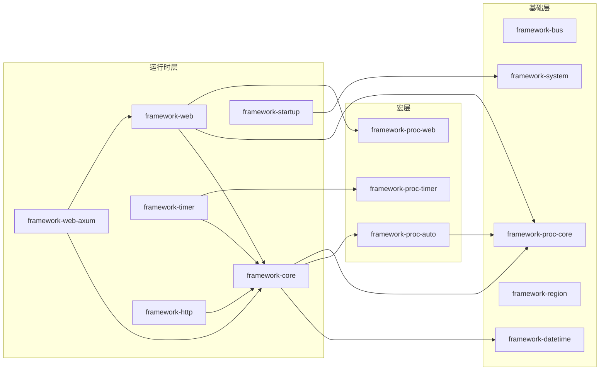

# 仓库结构与依赖

本仓库是 Cargo workspace，根 `Cargo.toml` 统一管理成员列表、公共包元数据
（`version`、`edition`、`rust-version`、`license` 等）与依赖版本，各 crate 通过
`workspace = true` 引用，不再单独写版本号。

## 目录结构

```text
lingting-rust-framework/
├── .cargo/config.toml      # 编译期 rustflags 与放宽的 lint
├── .github/workflows/      # CI，目前只有 publish.yml（tag 触发发布）
├── doc/                    # 各 crate 文档，入口 doc/readme.md
├── scripts/
│   ├── tag.sh              # 改版本号、同步 lock、commit、打 tag、推送
│   └── publish.sh          # 校验版本一致性后发布到 crates.io
├── framework-*/            # 14 个 workspace 成员 crate
├── Cargo.toml              # workspace 定义与共享依赖
├── LICENSE
├── README.md               # 项目介绍与文档索引
├── workspace.md            # 本文档
├── develop.md              # 开发、环境与发布
└── AGENTS.md               # Agent 工作说明
```

构建产物在 `target/`，本地临时计划与笔记在 `.plan/`，二者都不入版本库。
每个 crate 的目录只含 `Cargo.toml` 与 `src/`（`framework-region` 另含 `assets/` 与 `build.rs`，
`framework-bus` 含 `tests/`），对外文档统一放在 `doc/<crate>/README.md`，
并通过 crate `Cargo.toml` 的 `readme = "../doc/<crate>/README.md"` 指向该文件。

## 分层

| 层 | crate | 说明 |
|----|-------|------|
| 基础 | `framework-bus`、`framework-datetime`、`framework-region`、`framework-system`、`framework-proc-core` | 不依赖其他内部 crate |
| 宏 | `framework-proc-auto`、`framework-proc-timer`、`framework-proc-web` | 属性宏与代码生成，`framework-proc-web` 在 `collect` 特性下生成接口元数据注册代码 |
| 运行时 | `framework-core`、`framework-web`、`framework-web-axum`、`framework-timer`、`framework-startup`、`framework-http` | 依赖基础层与宏层，供业务直接使用 |

## 依赖方向

箭头指向被依赖的 crate；节点按层分组。



要点：

- `framework-core` 重导出 `framework-datetime` 的全部接口。
- `framework-web` 重导出 `framework-proc-web` 的宏；`framework-web-axum` 同时直接依赖
  `framework-core` 与 `framework-web`。
- `framework-web` 还直接依赖 `framework-proc-core` 并以 `#[doc(hidden)]` 重导出，
  供 `collect` 生成的路由与接口元数据注册代码引用，使用方无需自己声明该依赖。
- `framework-startup` 依赖 `framework-system` 做提权判断与命令调用。
- `framework-timer` 依赖 `framework-core`、`framework-proc-timer` 与 `inventory`（链接期任务注册）。
- `framework-http` 依赖 `framework-core`，复用其 `MultiStringValue` 表达请求头与响应头。
- `framework-bus` 与 `framework-region` 独立，无内部依赖。

## feature 传递

| feature | 所在 crate | 作用 |
|---------|-----------|------|
| `collect` | `framework-proc-core`、`framework-proc-auto`、`framework-proc-web`、`framework-web`、`framework-web-axum`（默认开启） | 开启基于 `inventory` 的静态注册，需在最终二进制所在的 crate 上启用；`framework-web/collect` 同时开启 `framework-proc-core/collect` 并让 `web_api` 生成接口元数据注册代码 |
| `ts` | `framework-proc-core`、`framework-web`、`framework-web-axum` | TypeScript 代码生成构建器（`framework-proc-core/ts`），默认关闭；`framework-web/ts` 会同时开启 `collect` |
| `rust` | `framework-proc-core`、`framework-web`、`framework-web-axum` | Rust crate 生成构建器（`framework-proc-core/rust`），默认关闭；`framework-web/rust` 会同时开启 `collect` |
| `generate` | `framework-timer` | 生成定时任务名称相关的 `syn` 支持，默认关闭 |
| `reqwest` | `framework-http` | reqwest 后端，默认关闭，未启用 `wreq` 时生效 |
| `wreq` | `framework-http` | 改用 wreq 后端并模拟 Chrome 的 TLS 指纹，默认关闭；与 `reqwest` 同时启用时使用本后端 |
| `ntp` / `tokio` | `framework-datetime` | NTP 校时及异步校时支持，默认关闭 |

## crate 文档索引

各 crate 的用途、用法与 feature 说明见 `doc/` 下对应目录（完整索引见 [doc/readme.md](doc/readme.md)）：

| crate | 文档 |
|-------|------|
| framework-bus | [doc/framework-bus/README.md](doc/framework-bus/README.md) |
| framework-core | [doc/framework-core/README.md](doc/framework-core/README.md) |
| framework-datetime | [doc/framework-datetime/README.md](doc/framework-datetime/README.md) |
| framework-http | [doc/framework-http/README.md](doc/framework-http/README.md) |
| framework-region | [doc/framework-region/README.md](doc/framework-region/README.md) |
| framework-startup | [doc/framework-startup/README.md](doc/framework-startup/README.md) |
| framework-system | [doc/framework-system/README.md](doc/framework-system/README.md) |
| framework-timer | [doc/framework-timer/README.md](doc/framework-timer/README.md) |
| framework-web | [doc/framework-web/README.md](doc/framework-web/README.md) |
| framework-web-axum | [doc/framework-web-axum/README.md](doc/framework-web-axum/README.md) |
| framework-proc-core | [doc/framework-proc-core/README.md](doc/framework-proc-core/README.md) |
| framework-proc-auto | [doc/framework-proc-auto/README.md](doc/framework-proc-auto/README.md) |
| framework-proc-web | [doc/framework-proc-web/README.md](doc/framework-proc-web/README.md) |
| framework-proc-timer | [doc/framework-proc-timer/README.md](doc/framework-proc-timer/README.md) |
